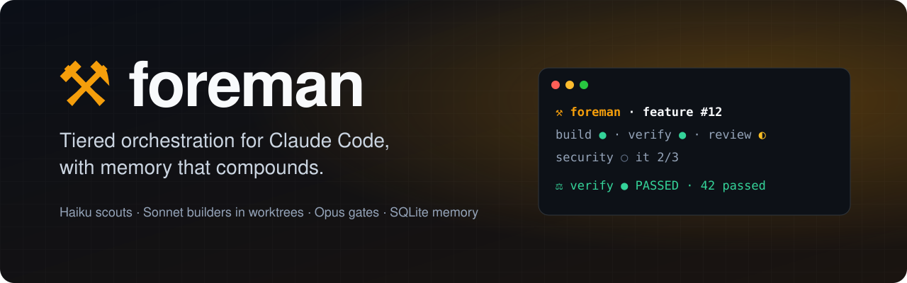
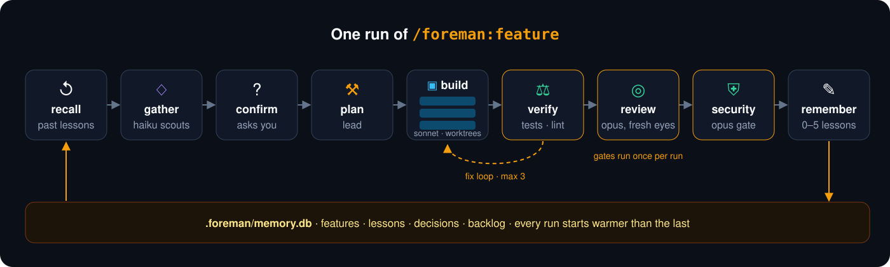
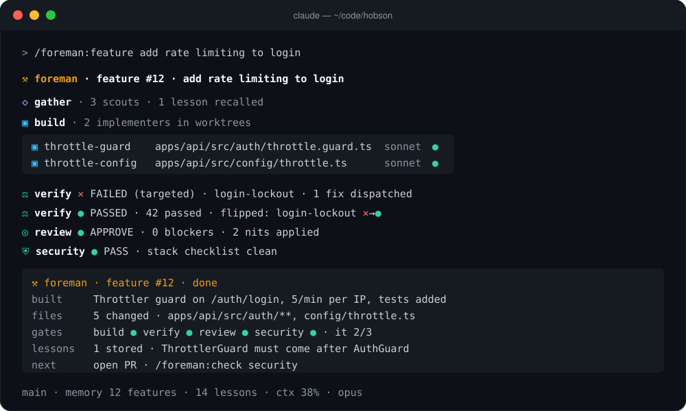
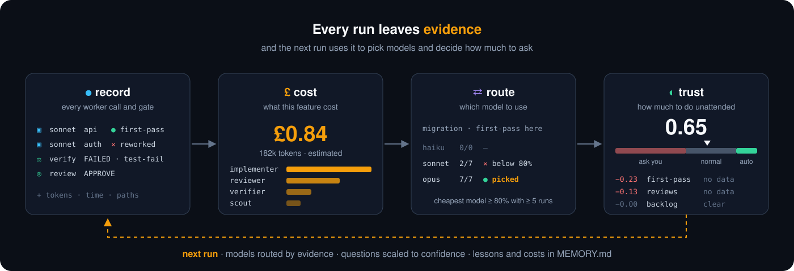

<p align="center">
  
</p>

<p align="center">
  
  
  
  
  
</p>

**Hand Claude Code a feature and get back verified, reviewed, security-checked work, plus a project memory that makes the next run faster.**

foreman runs one lead with cheap scouts, isolated implementers, and three gates that run **once per run**, backed by a zero-dependency SQLite memory so every run starts warmer than the last.

- **Right model for each job.** Haiku researches, Sonnet builds in parallel git worktrees, Opus reviews and runs the security gate.
- **Nothing ships unchecked.** Tests, types and lint, then a fresh-eyes review, then a security pass. Fix loops are capped, so it can't spin forever.
- **It learns your project.** Lessons, decisions and gotchas are stored after every run and handed to the next one.
- **Any stack.** `/foreman:map` fingerprints JS/TS, Python, Go, Rust, JVM, Ruby, PHP, .NET, mobile, infra, and installs matching skills.
- **Token-frugal.** Workers return summaries, not transcripts. Small tasks stay in the main loop.
- **Gets cheaper and calmer with use.** Every run records what each worker cost and whether its work passed first time. foreman shows you the bill, learns which model handles each kind of task in your repo, and asks less on work with a clean track record.

## Quick start

1. Install the plugin. At the prompt of a Claude Code terminal session:

   ```
   /plugin install foreman --marketplace RyanHelmn/foreman
   ```

   Answer `y` to add the marketplace, then pick a scope (user is first). From a shell: `claude plugin install foreman --marketplace RyanHelmn/foreman`. In the desktop app: click + next to the prompt box → Plugins → Add marketplace `RyanHelmn/foreman` → Add plugin.
2. In a project: `/foreman:map`. Commit `.foreman/`; it ships its own `.gitignore` that excludes `memory.db*` and `run.json`, so the map, stack guide, config, skills map, rules and `MEMORY.md` are committed and the live state isn't.
3. Optional `/foreman:config` (e.g. `reviewer=claude-fable-5-1`, `e2e=true`; `--user` for global defaults).

Then hand it work: `/foreman:feature add rate limiting to login`.

## How a feature run works

<p align="center">
  
</p>

<p align="center">
  
</p>

Design is distilled from Anthropic's published guidance (sources in `skills/orchestration-patterns/references/sources.md`): delegate only for context isolation, parallelism and independent judgement; split by context, not by role; verify with a fresh instance; bound every loop; fold everything else into the main agent.

## Commands

```
/foreman:map                     map the project (any stack), install stack skills, generate a stack guide,
                                 ask until confident, seed memory — run first, re-run to rebuild context
/foreman:feature <task>          recall → gather → ask → plan → build (parallel worktrees) → verify → fix loop
                                 → review → security → store lessons
/foreman:review [areas] [paths]  whole-project audit (security, performance, architecture, testing, dx, deps,
                                 observability, accessibility) → ranked backlog with plans
/foreman:suggestions [focus]     review the product vision, research comparable products, suggest what to build
                                 next (or say nothing is worth it) → product backlog items
/foreman:rules [add|remove]      project rules every Claude Code session and foreman worker follows
                                 (e.g. no new databases or containers, clean up worktrees)
/foreman:check [code|security]   diff-level review and/or security audit on demand
/foreman:tidy [paths]            remove dead code, align stragglers to the house patterns in verified batches,
                                 plan bigger refactors into the backlog
/foreman:recall <query>          search memory: features, decisions, lessons, backlog
/foreman:research <question>     parallel Haiku scouts, compact answer
/foreman:config                  models per role, test strategy, gates, worktrees, memory, prices,
                                 routing (static or evidence), autonomy thresholds
```

## Components

| Component | Purpose | Default model |
|---|---|---|
| `scout` | Read-only research, ≤300-word brief with `path:line` evidence | Haiku |
| `implementer` | One bounded unit in its own git worktree, ≤250-word report | Sonnet |
| `verifier` | Black-box tests/typecheck/lint; `targeted` per iteration, `full` once; never passes a partial run | Sonnet |
| `reviewer` | Independent diff review: correctness, fit, design, tests | Opus |
| `security-auditor` | Source→sink security gate using the stack guide + installed security skills | Opus |
| `auditor` | One-area whole-project audit (performance, architecture, testing, dx, deps, …) with plans | Opus |
| `SessionStart` hook | ~10-line memory briefing in mapped projects (zero tokens: shell + node) | — |
| `Stop` hook | Refuses to end a feature run while gates are pending; bounded; only in the owning session and within `gates.staleHours`; fails open | — |
| `hooks/status.ts` | Live line under the prompt for any foreman command (workers for map/review/research, gate rail during a feature, toasts when a gate passes or fails), and context handling: past `context.compactAt` (default 60%) it compacts between turns during a feature run, or suggests `/clear` once a foreman command has finished; every compaction keeps the run's state | — |
| `scripts/memory.mjs` | SQLite memory CLI (`node:sqlite`, FTS5 trigram), no npm install; also the evidence commands (`dispatch`, `gate`, `cost`, `routing`, `confidence`, `feature report`) | — |
| `priors.json` | Placeholder first-pass priors blended into routing and confidence | — |
| `scripts/statusline.sh` | Coloured status line: branch, memory counts, context %, model (the mod shows the run); installed by `/foreman:config statusline` | — |

## Look

Every command speaks one visual language (`skills/feature/references/style.md`) designed for Claude Code's markdown renderer: a bold `⚒ foreman · …` header, bold phase lines (`◇ gather`, `▣ build`, `⚖ verify`…), a one-line inline-code gate rail (`build ● · verify ◐ · review ○ · security ○`), a fenced worker roster with per-role sigils (◇ scout ▣ implementer ⚖ verifier ◎ reviewer ⛨ security ▤ auditor), verdict lines, and a fenced close block. No horizontal rules or box-drawing, which render badly in the terminal. `/foreman:config statusline` installs a coloured Claude Code status line that tracks the live run (feature, gates, iteration, context %, model) and shows branch + memory counts when idle. The memory CLI is coloured on a TTY, plain when piped, JSON with `--json`.

## Memory

`.foreman/memory.db` holds **features** (what was built, outcome, iterations, what flipped, review/security verdicts), **lessons** (gotchas, conventions, patterns, process — tied to paths), **decisions** (`[user-confirmed]` answers from the confidence loops), **backlog** (ranked findings from `/foreman:review`), plus two append-only evidence tables: **dispatches** (every worker call: role, model, task type, paths, tokens, duration, outcome, first-pass) and **gate_events** (every verify/review/security verdict with finding categories). Full-text search across the first four; path matching is by path segment, so `auth` matches `auth/guard.ts` but not `author.ts`.

Self-learning loop: `/foreman:feature` starts with `memory relevant` (lessons/decisions/backlog touching the task's paths and terms) and injects hits into worker briefs; it ends by storing the feature record and 0–5 specific lessons. `/foreman:review` writes the backlog; features close backlog items.

Git: the `.db` is ignored; `MEMORY.md` (human-readable + JSON snapshot, with each feature's cost and first-pass rate) is regenerated on every finish/export and committed, as are the per-feature reports in `.foreman/reports/`. A missing `.db` rebuilds from `MEMORY.md` automatically.

```
node --no-warnings <plugin>/scripts/memory.mjs briefing | recall <q> | feature list | feature report <id> | backlog list
                                              | cost <id> | routing | confidence --types T --paths P | export | import
```

## Evidence

<p align="center">
  
</p>

Every run records what each worker cost and whether its work survived first contact with the verifier, so foreman can tell you what a feature cost and, once there is enough history, which model to use and how much to do unattended.

- **Dispatches and gate events.** `/foreman:feature` logs every Agent call (role, model, unit, task type, paths, tokens, tool uses, duration, outcome) and every verify/review/security verdict with finding categories. After each verification, implementer dispatches are marked first-pass or reworked by whether their files were among the failures. Logging is CLI calls at phase boundaries only; no extra worker runs.
- **`memory cost <feature>`**: tokens and estimated cost split by role and by iteration, naming the priciest dispatch. `feature list` gains a cost column, `MEMORY.md` carries cost and first-pass rate per feature, and `feature report <id>` writes `.foreman/reports/<id>.md` (units, iterations, gate events, lessons, cost), committed alongside the map.
- **`memory routing [--type T] [--paths P]`**: first-pass rate, mean iterations and mean tokens per task type × model. `routing suggest --role implementer --type T` names the cheapest model that clears the threshold here, or falls back to your configured model with "insufficient evidence (n=N)". Local numbers are blended with the plugin's `priors.json`.
- **`memory confidence --types T,T --paths P`**: a 0–1 score and its three biggest contributors, from the first-pass rate for those task types, how often reviews on those paths needed changes, open critical/high backlog on them, and gotcha lessons on them. A fresh repo scores 0.65. The score sits on the gate rail and the status line during a run.

Two config groups drive it (`/foreman:config`):

```json
"routing":  { "mode": "static", "threshold": 0.8, "minSamples": 5 },
"autonomy": { "autoAt": 0.85, "askBelow": 0.5 }
```

`routing.mode: "evidence"` makes the plan pick each implementer's model with `routing suggest` and show why (`implementer: opus (sonnet first-pass on migration 2/7 here)`); the briefing suggests it once 10 finished features have dispatch records. With confidence at or above `autoAt`, foreman skips plan approval for non-destructive work and applies the reviewer's `convention`/`lint` should-fixes on files it already changed, checked once with your test-subset and typecheck commands. Below `askBelow`, it always stops after the plan and shows what lowered the score. `prices` (blended per million tokens, GBP by default) only feeds the estimates; edit them to match your plan.

## Any stack

`/foreman:map` identifies whatever is there (JS/TS, Python, Go, Rust, JVM, Ruby, PHP, .NET, mobile native, Expo/RN, Flutter, SQL/NoSQL, infra) and writes `.foreman/stack-guide.md` from the matching sections of `skills/map/references/stack-practices.md` and `stack-security.md` plus any skills it installs from the open ecosystem (`npx skills find` / `find-skills`). The guide is handed to every worker; installed skills are handed per role via `skills.json`. The guide also carries `skills/map/references/design-principles.md` (composition and consistency rules for any language), and the map records one **house pattern** per concern (data access, errors, forms, state…) with an exemplar file, so implementers copy the right way, the reviewer flags a second way, and `/foreman:tidy` moves stragglers over.

## Token economy

- Verification: targeted per iteration, full once at the end, e2e only when enabled.
- Review and security: once after convergence; re-runs on the delta only.
- Workers return summaries, never transcripts. `maxFixIterations` (3) and `gates.maxBlocks` (3) cap every loop.
- Tasks ≤2 files are done in the main loop.

## Requirements

Claude Code with plugins, git (worktrees), Node ≥ 22.13 (built-in SQLite) for memory and the briefing hook; `npx` optional for skill discovery. No API keys, no native modules.

Tests: `npm test` (Node's built-in runner, no dependencies) covers the stop gate and the memory CLI; the mod has its own `hooks/status.test.ts`.

## Customising

Agent prompts live in `agents/`; the loop in `skills/feature/SKILL.md`; the knowledge in `skills/map/references/` and `skills/feature/references/`. Add your own stack section to the references and `/foreman:map` will pick it up on the next run.
